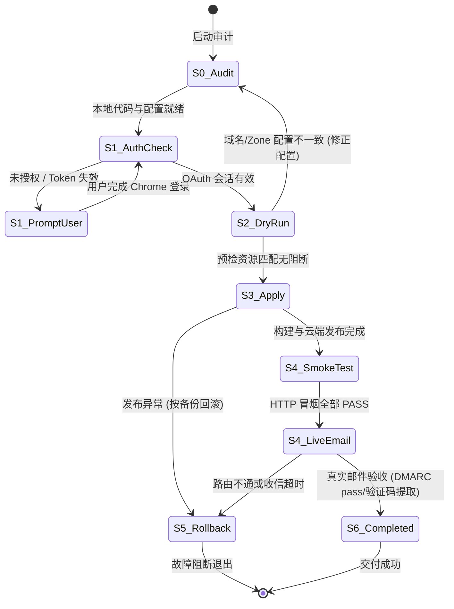

# AI Agent 自动化上线与运维手册

本手册专门面向自主执行的 AI Agent（如 Claude Code、OpenAI Codex、CPA 自动化流水线等）。其目标是让 Agent 在缺乏项目历史记忆的情况下，以确定性状态机和最严密的安全边界，全自主完成部署、运维与质量对账。

---

## 1. 核心铁律（Agent 执行红线）

执行 Agent **必须无条件遵守** 以下安全原则：

1. **绝对禁止泄露与打印凭据**：
   - 严禁在控制台输出、Agent 消息、Git 提交或持久化文件中记录任何 OAuth Access Token、Refresh Token 或 Cloudflare API Token。
   - `easytmp.config.json` 仅用于持久化公开资源 ID（`accountId`、`zoneId`、`d1DatabaseId`），绝不可混入密钥。
2. **OAuth 授权交互边界**：
   - Agent **绝对不要** 试图模拟输入密码、反向破解 OAuth 授权流或在无头终端伪造凭据。
   - 若检测到未登录，唯一合规操作是**向人类用户发起明确提示**：“请在具有界面的浏览器（如 Chrome）中执行 `pnpm exec wrangler login` 完成官方授权”。
3. **资源保护与零破坏原则**：
   - 若不存在明确需清理的旧 Worker，**绝对不执行任何删除操作**。
   - 绝不删除任何 Cloudflare D1 数据库、KV 命名空间或未关联的 DNS 记录。
   - 当前官方生产域 `cottage.dpdns.org` 上的旧服务 `email-code-worker` 已经安全下线；新自建环境默认无需清理旧服务，跳过清理阶段。
4. **保留邮件路由基础设施**：
   - Cloudflare Email Routing 托管的 MX 记录（`route1/route2/route3.mx.cloudflare.net`）和 SPF 记录是整个系统收信的基石，严禁擅自修改或删除。
5. **工作区状态保护**：
   - 检查工作区现有未提交代码或配置文件时，保持现有文件完整，**严禁执行 `git reset --hard` 或回滚他人未提交的工作**。
6. **部署入口唯一**：
   - 新环境上线只运行 `pnpm onboard` 与 `pnpm onboard --apply`。
   - `legacy:*` 脚本仅用于 `cottage.dpdns.org` 历史迁移。其他域名禁止执行 `pnpm legacy:deploy:orchestrate` 或 `pnpm legacy:cleanup:*`。

---

## 2. Agent 执行有限状态机 (FSM)



### 状态定义与迁移条件

#### S0: 仓库只读审计（Read-Only）
- **操作**：
  - 检查根目录 `easytmp.config.json` 是否存在。
  - 运行 `git status`，确认本地变更并保持现状。
- **转移条件**：`easytmp.config.json` 包含合法 `mailDomain` 字符串。

#### S1: 凭据与权限探测（Read-Only）
- **操作**：
  - 运行 `npx wrangler whoami --json`。
- **分支判定**：
  - 若 `loggedIn === true` 且包含 `accounts`：继续至 `S2`。
  - 若未登录：输出指引请求用户在 Chrome 中运行 `pnpm exec wrangler login`，挂起并等待。

#### S2: 资源预检与安全模拟（Read-Only）
- **操作**：
  - 运行 `pnpm onboard`（在代码实现中，不加 `--apply` 时严格默认执行 dry-run）。
- **核验项**：
  - Cloudflare Zone 必须处于 `active` 状态。
  - Zone 域名与 `mailDomain` 严格匹配。
  - 若存在同名 D1 或 Pages 项目，确认复用策略。
- **转移条件**：输出包含 `Resource discovery complete. No remote changes made.`。

#### S3: 自动化全栈上线（Mutating）
- **操作**：
  - 运行 `pnpm onboard --apply`。
- **自动执行链路**：
  1. 保证 D1 数据库与 Pages 实例存在，并把 `DB`、`MAIL_DOMAIN`、`WEB_HOSTNAME` 写入 Pages 生产配置。
  2. 回写公共 ID（`zoneId`, `accountId`, `d1DatabaseId`）至 `easytmp.config.json`。
  3. 执行 `pnpm build`（全模块构建与 Functions 预校验）。
  4. 应用远程 D1 Schema 迁移。
  5. 部署 Email Inbound Worker（包含 scheduled cron 清理触发器），等待脚本在账户中可见。
  6. 启用 Email Routing、等待就绪，将现有规则保存脱敏 JSON 备份至 `.wrangler/backups/`，更新 Catch-all 指向新 Worker。
  7. 部署 Pages 静态站与同源 `/api/*` Functions，绑定 `inbox.<mailDomain>` 自定义域名。
  8. 等待 Pages 域名与 HTTPS 就绪，执行 `/api/config`、健康、安全标头、随机地址和查询冒烟测试。
- **转移条件**：`onboard` 进程退出码为 `0` 且输出 `Deployment summary`。

#### S4: 端到端功能与真实收信验收
- **操作**：
  1. 调用 `pnpm smoke-test` 确保生产环境 `GET /api/health` 返回 `200`，`GET /api/config` 正常返回。
  2. 通过 API 生成随机邮箱并打印指引，由外部邮箱向该地址发送一封测试邮件。
  3. 轮询收件箱接口，断言 `dmarcPass === true` 且 `codeCandidates` 包含发送的正文验证码。
- **转移条件**：所有验收项符合预期。

---

## 3. Agent 执行任务清单（Checklist）

Agent 在执行任务时可逐项核对并向用户汇报进度：

```markdown
- [ ] 1. 检查根目录配置 easytmp.config.json 格式与域名合法性
- [ ] 2. 检查 Wrangler OAuth 登录态（npx wrangler whoami --json）
- [ ] 3. 运行 pnpm onboard 确保 Zone 与 Account 探测无误（Dry-Run）
- [ ] 4. 运行 pnpm onboard --apply 执行端到端构建、迁移与部署
- [ ] 5. 核对并持久化发现的公开 ID，确保无密钥泄漏
- [ ] 6. 运行 pnpm smoke-test 验证生产 HTTP 端点健康状态
- [ ] 7. 发送真实邮件并验收 DMARC pass 与验证码抽取
- [ ] 8. 输出最终服务访问地址与 API 对接凭证
```

---

## 4. 异常处理与失败回滚 (Rollback)

在自动化部署中发生任何非预期异常时，Agent 应遵循以下恢复流程：

### 1. D1 远程迁移失败
- **现象**：`pnpm onboard --apply` 在 `migrateRemote` 阶段报错。
- **恢复策略**：
  - 核查 `CLOUDFLARE_D1_DATABASE_ID` 是否为合法 UUID v4，禁止使用占位符。
  - 查看 `packages/db/migrations/0001_initial.sql` 是否与远程数据库既有表产生冲突。
  - 严禁随意 DROP 远程数据库表。

### 2. Email Routing Catch-all 规则切换异常
- **现象**：邮件路由更新后，外部发信出现弹回或退信。
- **恢复策略**：
  - 脚本在更新前已在 `.wrangler/backups/` 目录下生成类似 `email-routing-backup-YYYY-MM-DDTHH-mm-ss-sssZ.json` 的快照。
  - Agent 可以读取该备份文件的 `data.catchAllRule` 原配置，通过 Cloudflare API 将规则还原为旧规则。
  - 恢复命令参考：
    ```sh
    node -e "
    const fs = require('fs');
    // 查看最近一次备份文件
    const backups = fs.readdirSync('.wrangler/backups').filter(f => f.startsWith('email-routing-backup'));
    console.log('可用路由备份:', backups);
    "
    ```

### 3. 自定义域名处于 Initializing / Pending 状态
- **现象**：`inbox.<mailDomain>` 无法解析或 HTTPS 证书颁发中。
- **恢复策略**：
  - Cloudflare Pages 绑定自定义域名需要数秒至数分钟同步 DNS。
  - Agent 应当以指数退避方式轮询 `https://inbox.<mailDomain>/api/health`（每次等待 10s、20s、30s，最多 3 分钟），而非立即判定失败。

---

## 5. 完成判定准则

当且仅当满足以下全部条件时，Agent 方可宣告任务完成：

1. `easytmp.config.json` 包含准确的 `mailDomain`，且自动持久化了 `accountId`, `zoneId`, `d1DatabaseId`。
2. `https://inbox.<mailDomain>/api/health` 返回 `status: "ok"` 与有效 `serverTime`。
3. `https://inbox.<mailDomain>/api/config` 返回非私密的公共配置与 7 天保留时长（`retentionSeconds: 604800`）。
4. 真实外部邮件投递测试成功，邮件能被检索，且 `dmarcPass: true`。
5. 没有向仓库提交任何多余的临时文件（如 `.wrangler/tmp` 已被清理）。
