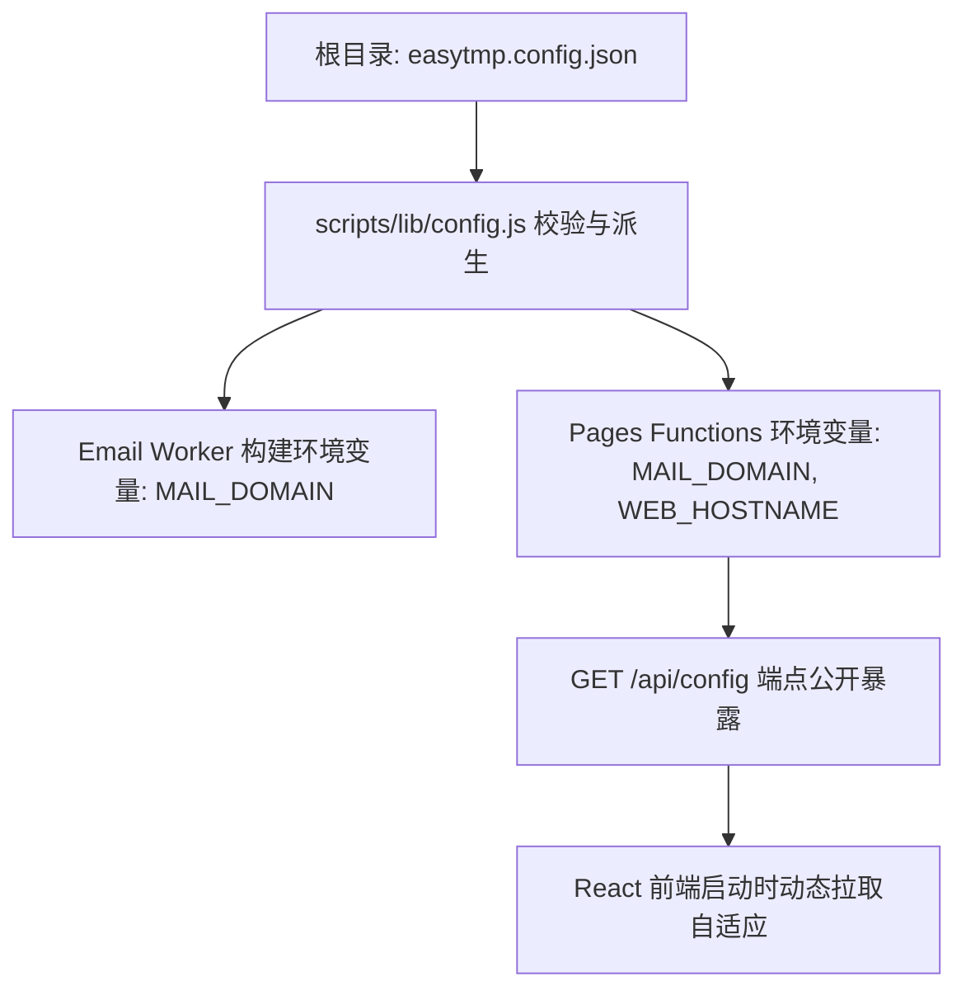

# 代码架构、模块编辑与二次开发指南

本指南面向希望对 Cloudflare EasyTmp Mail 进行功能定制、接口拓展、前端改造或 Bug 修复的开发者。文档解析全仓 Monorepo 目录划分、域名与配置单一来源、各业务端修改规范及发布前质量门禁。

---

## 1. 全仓代码架构 (Monorepo Architecture)

本项目采用 `pnpm workspace` 进行模块化治理，各包之间职责高度解耦，边界清晰：

```text
cloudflare-easytmp-mail/
├── packages/
│   ├── shared/         # 纯业务逻辑与类型定义 (无环境依赖)
│   └── db/             # D1 Schema 迁移与 Repository 数据访问层
├── apps/
│   ├── api/            # Cloudflare Pages Functions (/api/*) 与全栈产物打包入口
│   ├── inbound-worker/ # Cloudflare Email Worker 与 Cron Trigger 定时清理
│   └── web/            # React 18 + Vite 静态前端页面
├── scripts/            # 自动化 Onboarding、凭据解析与 Cloudflare 部署套件
├── docs/               # 完整文档体系与 OpenAPI 规范
└── easytmp.config.json # 全仓单一配置事实源
```

### 核心包职责矩阵

| 模块目录 | 核心技术栈 | 职责与关键文件 |
| --- | --- | --- |
| `packages/shared` | TypeScript | **数据合同与工具**：<br>• `types/`: API 响应结构、错误码定义<br>• `mime/dmarc.ts`: 严格 Cloudflare MTA (`mx.cloudflare.net`) DMARC 防伪造认证<br>• `mime/parser.ts`: MIME 邮件解析与正文提取<br>• `sanitizer/html.ts`: 基于 `parse5` 白名单的安全清洗与样式隔离<br>• `extractor/`: 纯文本中 4-12 位验证码及链接智能提取<br>• `cursor/`: 严格基于 `(receivedAt, id)` 的安全 Base64URL 分页游标 |
| `packages/db` | TypeScript, SQL | **数据库访问**：<br>• `migrations/0001_initial.sql`: 初始建表、索引与 7 天到期 CHECK 约束<br>• `repository.ts`: 封装所有 D1 SQL 查询，确保强制携带过期时间边界检查<br>• `mock.ts`: 内存级 D1 Mock 实现，供无云端环境下的单元测试运行 |
| `apps/web` | React 18, Vite | **前端交互**：<br>• `hooks/useMailbox.ts`: 权威服务端数据对账、3 秒自适应轮询、不可见时挂起定时器<br>• `components/AddressBar.tsx`: 邮箱前缀输入、随机切换、复制地址<br>• `components/SandboxIframe.tsx`: `srcdoc` 隔离沙箱，彻底封堵 XSS 与外链追踪 |
| `apps/api` | Hono, Pages | **全栈 API**：<br>• `functions/api/[[route]].ts`: 基于 Hono 的轻量 REST API 路由系统<br>• `build.js`: 自动将 Web 构建产物同步至 API 目录并由 Wrangler 打包校验 |
| `apps/inbound-worker` | Cloudflare Worker | **邮件接收与定时任务**：<br>• `src/index.ts`: `email()` 邮件接收处理入口与 `scheduled()` 定时过期清理入口<br>• `src/stream.ts`: 流式读取，防范超大邮件炸弹（1MB 默认，2MB 硬限） |
| `scripts` | Node.js (ESM) | **自动化运维**：<br>• `onboard.js`: 5 分钟极速上线主控脚本<br>• `lib/cloudflare-oauth.js`: 本地 OAuth 会话解析，零凭据持久化 |

---

## 2. 域名与配置的数据流向

在以往的无服务器架构中，域名往往硬编码在各个构建文件或前端环境变量中，导致多环境移植极其繁琐。**本项目严格保证根目录 [easytmp.config.json](../easytmp.config.json) 为全局唯一事实源**：



- **前端动态自适应**：前端在打开时优先请求同源的 `/api/config` 端点，动态获知当前部署的 `mailDomain`、`webHostname` 和 7 天保留策略，**绝不硬编码任何域名**。
- **配置防篡改与安全持久化**：`scripts/onboard.js` 会在云端发现资源后，自动将公共的 `accountId`、`zoneId` 和 `d1DatabaseId` 写入 `easytmp.config.json`，确保重复执行具有绝对幂等性。

---

## 3. 常见修改场景与操作指南

### 3.1 场景 A：新增或修改 API 接口与字段

当需要为临时邮箱增加新的查询维度或字段时：

1. **修改共享类型契约**：
   在 `packages/shared/src/types/index.ts` 中更新相关接口（如 `MessageSummary` 或 `ServiceConfigResponse`）。
2. **实现 API 路由逻辑**：
   打开 `apps/api/functions/api/[[route]].ts`：
   - 在 Hono 实例中添加对应路径 handler。
   - 确保使用中间件自动生成的 `serverTime` 和 `requestId`。
   - GET/DELETE 请求严格遵守无请求体规则。
3. **补充接口测试**：
   在 `apps/api/test/` 下的对应测试套件（如 `messages.test.ts` 或 `mailboxes.test.ts`）编写用例。
4. **同步更新规范与文档**：
   - 在 [docs/openapi.yaml](openapi.yaml) 中补充端点路径与 Schema 定义。
   - 在 [docs/api.md](api.md) 中补充人工中文说明。

### 3.2 场景 B：调整 Inbound Worker 收信规则与 DMARC 策略

1. **调整 DMARC 校验机制**：
   - 核心防线位于 `packages/shared/src/mime/dmarc.ts`。系统严格只信任 Cloudflare MTA 的首个标头，且验证 `authserv-id` 严格为 `mx.cloudflare.net`。
2. **调整邮件接收大小限制**：
   - 修改 `apps/inbound-worker/src/config.ts` 中的默认配置，并确保处于架构硬限范围内（1KB - 2MB）。
3. **单测套件验证**：
   运行 `pnpm --filter @easytmp/inbound-worker test`，确保伪造头、中继多跳头及正文注入头等攻击测试均 100% 拦截。

### 3.3 场景 C：修改数据库 Schema 与 D1 存储

1. **创建增量迁移文件**：
   在 `packages/db/migrations/` 目录下按编号添加新 SQL 文件（例如 `0002_add_index.sql`）。
2. **更新 Repository 访问层**：
   修改 `packages/db/src/repository.ts` 与 `packages/db/src/queries.ts`，保证所有涉及时间的逻辑严格使用毫秒数，并且始终带有时效边界判断。
3. **本地与单元测试验证**：
   运行 `pnpm --filter @easytmp/db test`。

### 3.4 场景 D：改进 Web 交互与界面展现

1. **界面与交互开发**：
   在 `apps/web/src/` 中调整组件逻辑。注意保持无障碍设计、深浅色区块对比与移动端适配。
2. **轮询状态机验证**：
   `apps/web/src/hooks/useMailbox.ts` 是收信核心状态机。任何改动必须保证：
   - 不改变单封删除只弹窗一次的交互约定。
   - 页面切换到后台（`document.visibilityState === 'hidden'`）时彻底停止定时器，切换回前台时立即触发一次权威对账刷新。

---

## 4. 本地质量门禁 (Quality Gates)

在提交任何代码或准备发布前，必须在本地依次执行以下门禁检查：

### 门禁一：全仓静态代码检查与格式化 (pnpm check)

```sh
pnpm check
```
本命令会自动运行：
- 全项目 TypeScript 类型检查（`pnpm typecheck`）
- ESLint 代码规则静态分析（`pnpm lint`）
- Prettier 代码格式化风格校验（`pnpm format`）

### 门禁二：全仓自动化单元与集成测试 (pnpm test:all)

```sh
pnpm test:all
```
本命令运行 Vitest 全套测试用例，涵盖：
- API 协议语义、参数校验、异常状态码覆盖
- MIME 复杂邮件解析、带前导零验证码提取
- DMARC 伪造攻击拦截测试
- D1 Repository 内存级数据库查询逻辑
- 前端 React 轮询生命周期状态机

### 门禁三：全仓生产打包构建 (pnpm build)

```sh
pnpm build
```
验证所有 npm workspace 包编译打包流程，确保 Pages Functions 经由 Wrangler 校验打包无缺少依赖或语法错误。

---

## 5. 发布与上线验收清单

完成代码编辑后，按以下清单验收并发布：

```markdown
- [ ] 1. 本地运行 pnpm build 确保零构建错误
- [ ] 2. 检查 git status，确认仅包含预期的代码改动，无临时文件入库
- [ ] 3. 运行 pnpm onboard 检查预检输出（Dry-Run）
- [ ] 4. 运行 pnpm onboard --apply 完成云端增量部署
- [ ] 5. 使用真实外部邮箱发送一封测试邮件，确认正常收取与解析
```
