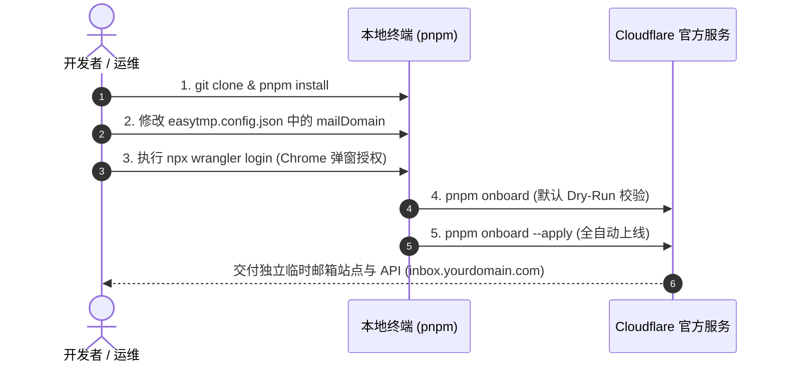

# 5 分钟上手与部署指南

Cloudflare EasyTmp Mail 具备完全可移植性。任何使用者只需准备一个托管在 Cloudflare 上的域名，修改 **1 个根配置文件**，并在浏览器（如 Google Chrome）中授权 **1 次 Cloudflare 官方 OAuth 登录**，即可在 5 分钟内一键拉起属于你自己的临时接码邮箱全栈系统。

---

## 1. 准备条件

在开始前，请确保具备以下环境与资源：

1. **Node.js 与 包管理器**：
   - Node.js `>= 20.0.0`
   - `pnpm >= 9.0.0`（全仓通过 pnpm workspace 管理）
2. **Cloudflare 账户与域名**：
   - 一个正常的 Cloudflare 免费或付费账户。
   - 一个已添加至该 Cloudflare 账户并处于 **Active（已激活，DNS 指向 Cloudflare）** 状态的域名（例如 `yourdomain.com`）。
   - **Cloudflare Email Routing**：在该域名的 Cloudflare 控制台左侧进入 `Email Routing`（电子邮件路由），完成初始开通（确保状态为 `ready`，默认 DNS MX 记录已由平台写入）。
3. **本地开发机器**：
   - 带有图形界面浏览器（推荐 Google Chrome）以完成官方 OAuth 授权跳转。

---

## 2. 极简部署四步走



### 第一步：克隆仓库与安装依赖

```sh
git clone https://github.com/your-org/cloudflare-easytmp-mail.git
cd cloudflare-easytmp-mail

# 使用已锁定的依赖锁文件安装
pnpm install --frozen-lockfile
```

### 第二步：修改唯一域名配置

打开仓库根目录下的 [easytmp.config.json](../easytmp.config.json)，将 `mailDomain` 替换为你的目标收信域名。

**最小化配置（推荐）**：

```json
{
  "mailDomain": "yourdomain.com"
}
```

> **系统自动派生规则**：
>
> 当只填写 `mailDomain` 时，系统会自动计算最佳命名：
> - **Web 与 API 域名** (`webHostname`)：`inbox.yourdomain.com`（必须是 mailDomain 的子域）
> - **Pages 静态项目名** (`projectName`)：`easytmp-yourdomain`
> - **Email Worker 脚本名** (`workerName`)：`easytmp-yourdomain-worker`
> - **D1 数据库名** (`d1DatabaseName`)：`easytmp-yourdomain`
>
> *(对于官方现有生产域名 `cottage.dpdns.org`，系统自动兼容历史命名 `easytmp-mail` 与 `easytmp-mail-inbound`)*。

### 第三步：授权 Cloudflare OAuth 登录

无需手工创建或复制包含大量复杂权限的 Cloudflare API Token。只需在终端运行：

```sh
pnpm exec wrangler login
```

1. 终端将自动呼起本地默认浏览器（推荐 Google Chrome）。
2. 在 Cloudflare 官方页面确认登录并点击 **Allow（授权）**。
3. 授权成功后，可在终端运行 `npx wrangler whoami` 验证登录状态，确保显示正确的 Cloudflare 账户名称与 Account ID。

> **安全须知**：授权凭据仅保存在本地操作系统的 Wrangler 安全配置中，**绝不会被脚本打印、记录或提交至代码库**。

### 第四步：安全预检与正式部署

`pnpm onboard` 的默认行为是不可变更云端的 dry-run；只有显式追加 `--apply` 才允许写 Cloudflare。

#### 1. 运行预检（Dry-Run）

```sh
pnpm onboard
# 或者显式执行：pnpm onboard --dry-run
```

**预检预期输出**：
- 成功读取 `easytmp.config.json`。
- 通过 OAuth 凭据自动解析出唯一的 Account ID。
- 检索到目标 Zone 处于激活状态，且 Zone 名称与 `mailDomain` 严格相符。
- 探测远程 D1 数据库与 Pages 项目是否存在（若不存在，会标记将在 apply 时自动创建）。
- 输出 `[easytmp] [DRY-RUN] Resource discovery complete. No remote changes made.`，未修改云端任何状态。

#### 2. 正式执行云端部署（Apply）

确认预检信息无误后，添加 `--apply` 标志执行实际云端创建与部署：

```sh
pnpm onboard --apply
```

**部署流程自动执行**：
1. **自动创建基础设施**：在 Cloudflare 自动创建 D1 数据库（亚太区域，默认 `apac`）及 Pages 前端项目。
2. **安全记录公开 ID**：将自动发现的 `accountId`、`zoneId` 和 `d1DatabaseId` 回写至 `easytmp.config.json`（仅持久化公开资源 UUID，绝不写入任何密钥）。
3. **本地编译与质量门禁**：自动按序构建 shared、db、web 前端、Pages Functions 打包验证及 Inbound Worker 打包。
4. **D1 Schema 迁移**：将建表及 7 天 CHECK 约束自动应用到远程 Cloudflare D1 生产库。
5. **部署 Email Inbound Worker**：发布包含 MIME 解析、严格 DMARC 验证及 10 分钟 Cron 过期清理触发器的 Worker。
6. **配置 Email Routing Catch-all**：自动拉取云端路由配置并在变更前自动生成本地 JSON 备份至 `.wrangler/backups/`，将收件 Catch-all 规则定向到新部署的 Email Worker。
7. **部署 Pages 与绑定自定义域名**：打包 React 静态资源及同源 Pages Functions (`/api/*`)，配置 `inbox.yourdomain.com` 的代理 CNAME 并绑定到 Pages 项目。
8. **自动执行冒烟测试**：对部署上线的站点执行 API 健康检查、CSP 安全标头与随机邮箱生成探测。

**成功输出示例**：

```text
[easytmp] Deployment summary:
{
  "ok": true,
  "accountId": "0123456789abcdef0123456789abcdef",
  "zoneId": "fedcba9876543210fedcba9876543210",
  "mailDomain": "yourdomain.com",
  "webHostname": "inbox.yourdomain.com",
  "d1Name": "easytmp-yourdomain",
  "d1DatabaseId": "8a3c0000-0000-4000-8000-000000000000",
  "pagesProject": "easytmp-yourdomain",
  "worker": "easytmp-yourdomain-worker",
  "next": "Send one external email to <random-name>@yourdomain.com and verify it through https://inbox.yourdomain.com/api/v1."
}
```

---

## 3. 第一次真实收信端到端验收

自动化部署完成后，必须通过一封来自真实互联网的邮件完成全链路验收。

### 步骤 A：生成验收临时邮箱

打开浏览器访问你的站点 `https://inbox.yourdomain.com`，或通过 API 获得随机邮箱：

```sh
curl -s https://inbox.yourdomain.com/api/v1/addresses/random
```

返回示例：
```json
{
  "name": "qa892b1cf03a749e",
  "address": "qa892b1cf03a749e@yourdomain.com",
  "serverTime": 1793671200000
}
```

### 步骤 B：从外部发信

使用外部真实邮箱（如 Gmail、Outlook、QQ 邮箱等）向 `qa892b1cf03a749e@yourdomain.com` 发送一封测试邮件：

- **邮件主题**：`EasyTmp 上线验收`
- **邮件正文**：
  ```text
  你好！欢迎使用 EasyTmp 临时邮箱。
  你的注册验证码是：439271
  请访问以下链接完成验证：https://example.com/verify?code=439271
  ```

### 步骤 C：查验收取结果

在网页端查看实时收件箱，或调用接口查询：

```sh
curl -s "https://inbox.yourdomain.com/api/v1/mailboxes/qa892b1cf03a749e/messages"
```

**验收通过判定标准**：
1. **秒级到达**：邮件在发送后数秒内即可被查询到。
2. **认证状态**：`dmarcPass` 字段必须为 `true`（经 Cloudflare Email Routing MTA 认证）。
3. **验证码提取**：`codeCandidates` 数组中准确提取出 `439271`，且保留前导零与文本上下文。
4. **生命周期校验**：`expiresAt` 必须精准等于 `receivedAt + 604800000`（精确 7 天后到期）。
5. **排版呈现**：网页端或 `htmlBody` 字段清洗安全，保留基础样式且运行在安全沙箱环境中。

---

## 4. 常见问题与排障指引

### Q1: 运行 `pnpm onboard` 报错 `[ZONE_REQUIRED]`
- **原因**：你的 Cloudflare 账户中没有名为 `mailDomain` 的激活域名。
- **排查**：登录 Cloudflare 网页控制台，确认域名已添加且 DNS Nameservers 已更改生效（Status 必须为 `Active`）。

### Q2: 报错 `[EMAIL_ROUTING_NOT_READY]`
- **原因**：该域名的 Cloudflare Email Routing 未完成开通或正处于初始化状态。
- **排查**：进入 Cloudflare 域名的控制台 -> `Email Routing`，根据平台引导开通并添加推荐的 DNS 记录，确保界面显示 `Email Routing is enabled`。

### Q3: 报错 `Found N Cloudflare accounts`
- **原因**：当前 OAuth 用户有权访问多个 Cloudflare 账户，系统无法自动猜测目标。
- **排查**：在 `easytmp.config.json` 中明确指定你要部署的 32 位十六进制 `accountId`，或在环境变量中执行 `export CLOUDFLARE_ACCOUNT_ID="你的账户ID"`。

### Q4: 网页能打开，但调用 API 或收信提示错误
- **排查**：
  1. 确认 Pages 是否正常绑定了 D1 数据库：在 Cloudflare Dashboard -> `Workers & Pages` -> 进入你的 Pages 项目 -> `Settings` -> `Functions` -> `D1 Database Bindings`，检查是否存在变量名为 `DB` 的绑定。
  2. 确认自定义域名 DNS 已生效：`inbox.yourdomain.com` 应该作为橙色云朵（Proxied）CNAME 指向 `<projectName>.pages.dev`。

### Q5: OAuth 授权过期或凭据失效
- **排查**：直接运行 `pnpm exec wrangler logout` 然后重新运行 `pnpm exec wrangler login` 即可刷新本地 OAuth 会话。
