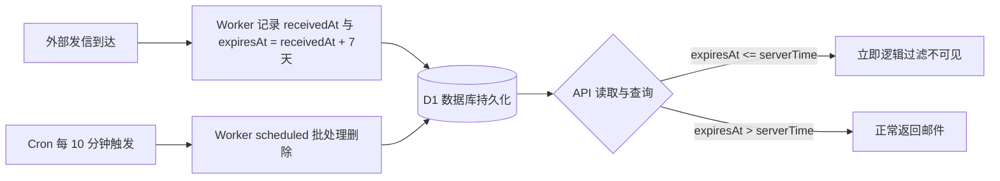

# 运维巡检、定时清理、变更与灾备手册

本手册面向负责 Cloudflare EasyTmp Mail 生产运行的 SRE、运维工程师及管理员。文档详述系统日常监控、7 天生命周期 Cron 定时清理机制、D1 数据库维护、域名变更与服务回滚全流程。

---

## 1. 日常巡检与健康监控

### 1.1 核心 HTTP 端点自动化探测

系统暴露轻量存活与配置检查接口，适合接入 UptimeRobot、Prometheus、Cloudflare Health Checks 等监控探针：

- **存活探测**：`GET https://inbox.<mailDomain>/api/health`
  - 预期返回：`200 OK`，`status: "ok"`
  - 判定准则：响应时间通常小于 150ms。若出现连续 `503`，表明底层 Cloudflare D1 或网络波动。
- **配置探测**：`GET https://inbox.<mailDomain>/api/config`
  - 预期返回：`200 OK`，核验返回的 `mailDomain` 和 `webHostname` 与当前环境一致。

### 1.2 Cloudflare 控制台核心指标关注点

登录 Cloudflare Dashboard，重点监控以下四个面板：

1. **Workers & Pages -> Inbound Worker (`easytmp-mail-inbound`)**：
   - **Invocations**：邮件接收调用量曲线。
   - **Errors**：执行异常数（重点关注 DMARC 拒绝日志与流式读取超限日志）。
   - **Cron Triggers**：定时任务执行状态。
2. **Workers & Pages -> Pages (`easytmp-mail`)**：
   - **Requests & Bandwidth**：前端静态资源访问与同源 `/api/*` 请求流量。
   - **Functions Metrics**：Pages Functions 执行耗时（P95 建议维持在 50ms 内）。
3. **Storage & Databases -> D1 (`easytmp-mail`)**：
   - **Database Size**：已用存储容量。
   - **Read / Write Rows**：行读取与写入监控，确保无慢查询或全表扫描。
4. **Email -> Email Routing**：
   - 确认状态始终保持为 `Enabled (Active)`。

---

## 2. 7 天生命周期与 Cron 定时物理清理



### 2.1 双重保障机制（逻辑过滤 + 物理销毁）

- **第一重：数据库 Schema 硬约束**
  在建表迁移 `packages/db/migrations/0001_initial.sql` 中强制施加：
  ```sql
  CHECK (expires_at = received_at + 604800000)
  ```
  保证所有存入 D1 的邮件到期时间严格为接收后精确 7 天（604,800,000 毫秒）。
- **第二重：查询层逻辑过滤**
  API 在接收任何请求时，会在中间件捕获精确的 `serverTime`。所有 SQL 查询强制携带 `WHERE expires_at > ?`。即便物理删除存在时间差，到期邮件在接口层面即刻彻底不可见。
- **第三重：物理批处理销毁 (Cron Trigger)**
  在 `apps/inbound-worker/wrangler.toml` 中配置了定时触发器：
  ```toml
  [triggers]
  crons = ["*/10 * * * *"] # 每 10 分钟执行一次
  ```
  Worker 的 `scheduled()` handler 自动运行批处理清理：
  - 单批次删除限额：`cronBatchSize = 100` 条
  - 单次运行上限限额：`cronMaxTotalDelete = 1000` 条
  - 这种渐进式设计既防止突发邮件量导致 Worker 执行超时（Wall-time 超限），又能平稳释放 D1 存储。

### 2.2 验证定时任务运行

可以在 Cloudflare Dashboard 中进入 Inbound Worker，在 `Logs -> Real-time Logs` 中观察定时执行事件，正常输出格式为：
```text
Cron scheduled cleanup deleted N expired messages
```

---

## 3. D1 数据库运维与 Schema 变更

### 3.1 查看未应用的远程迁移

当有新的数据库 Schema 变更提交到 `packages/db/migrations/` 时，可先进行只读检查：

```sh
# 列出远程 D1 待应用的迁移
pnpm db:migrate:remote
```

### 3.2 应用远程迁移

确认迁移脚本无破坏性语句后，执行正式应用：

```sh
pnpm db:migrate:remote --apply
```

> **灾备须知**：
> - D1 不支持原生 DDL 回滚事务。新增表、新增索引为安全变更；修改现有字段应通过增量字段实现。
> - 临时邮箱数据具有 7 天自销毁特性，无需进行永久备份，但数据库 Schema 必须通过 Git 严格版本控制。

---

## 4. 域名变更与系统平滑迁移

若业务需要切换或升级收信域名（例如从 `cottage.dpdns.org` 变更为 `newmail.com`）：

1. **在 Cloudflare 添加新域名**：
   - 将 `newmail.com` 添加至 Cloudflare 账户，修改域名注册商的 NS 解析并激活。
   - 无需手工开通 Email Routing，`onboard --apply` 会自动完成。
2. **修改根配置文件**：
   打开 [easytmp.config.json](../easytmp.config.json)，修改：
   ```json
   {
     "mailDomain": "newmail.com"
   }
   ```
3. **执行迁移上线**：
   ```sh
   # 1. 安全预检
   pnpm onboard
   # 2. 正式发布并重新绑定
   pnpm onboard --apply
   ```
   部署脚本将自动：
   - 在新 Zone 下创建对应的 D1/Pages 绑定。
   - 将 D1 `DB`、`MAIL_DOMAIN` 和 `WEB_HOSTNAME` 写入 Pages 生产配置。
   - 启用 Email Routing 并配置 Catch-all 规则。
   - 绑定并配置 `inbox.newmail.com` 的代理 CNAME。

---

## 5. 服务重新部署与组件级更新

无需每次都执行完整的全流程 onboarding，针对特定模块可单独发布：

| 操作目标 | 命令 | 说明 |
| --- | --- | --- |
| **仅重新部署 Email Worker** | `pnpm deploy:worker --apply` | 用于 Inbound Worker 代码、DMARC 逻辑或清理策略变更 |
| **仅重新部署 Pages 前端与 API** | `pnpm deploy:pages --apply` | 用于 Web UI 界面、样式或 Pages Functions (`/api/*`) 逻辑变更 |
| **全系统自动化重新发布** | `pnpm onboard --apply` | 全链路重新构建、迁移、发布并执行冒烟测试 |

> 新域名、新环境与日常重部署均使用 `pnpm onboard --apply`。`legacy:*` 命令只为 `cottage.dpdns.org` 历史迁移保留，脚本会拒绝其他域名。

---

## 6. 故障回滚与灾难恢复

### 6.1 Email Routing 路由规则回滚

每次执行 `pnpm onboard --apply` 或 `pnpm email-routing:apply` 时，自动化脚本均会在本地 `.wrangler/backups/` 目录下生成时间戳备份文件（例如 `email-routing-backup-2026-11-03T16-16-04-497Z.json`）。

若路由切换后出现收信异常，可以查看该备份文件并快速恢复原始 Catch-all 规则：

```sh
# 查看历史备份
ls -lt .wrangler/backups/email-routing-backup-*.json | head -n 5
```

备份文件中包含了原始的 `catchAllRule` 配置（动作类型与转发目标），可在 Cloudflare 网页控制台直接手动输入还原，或调用 Cloudflare REST API 还原。

### 6.2 Pages 静态前端与 Functions 回滚

Cloudflare Pages 对每次部署均自动生成不可变的 Deployment ID：
1. 打开 Cloudflare 控制台 -> `Workers & Pages` -> 进入你的 Pages 项目。
2. 点击 `Deployments` 选项卡。
3. 找到先前稳定运行的历史版本，点击右侧操作菜单选择 **Rollback to this deployment**。
4. 全球 CDN 节点将在几秒内无缝秒级回退至历史稳定版本。

---

## 7. OAuth 会话失效与 Token 轮换

本系统采用 Cloudflare Wrangler 本地 OAuth 会话机制，无需长期维护具有高危权限的静态 API Token。

- **凭据失效现象**：运行脚本时抛出 `[AUTH_REQUIRED]` 错误。
- **刷新恢复方案**：
  ```sh
  # 1. 退出旧会话
  pnpm exec wrangler logout
  # 2. 呼起浏览器重新登录授权
  pnpm exec wrangler login
  # 3. 验证当前登录态与账户列表
  pnpm exec wrangler whoami
  ```

---

## 8. 日志脱敏与安全保留规范

1. **零 PII（个人敏感信息）日志**：
   - Email Inbound Worker 与 API 端点严禁在控制台打印邮件原始正文、验证码明文或完整链接。
   - 定时清理仅输出汇总日志（如 `deleted N expired messages`）。
2. **零凭据提交**：
   - `.gitignore` 已配置忽略 `.wrangler` 目录下的所有临时配置文件和 OAuth 临时缓存。
   - 提交 Git 前运行 `git diff` 确保没有任何密钥入库。
3. **生产历史资源记录**：
   - 官方生产域 `cottage.dpdns.org` 上的旧历史服务 `email-code-worker` 已于 2026-11-03 彻底下线并清理。
   - 平台托管 MX 记录与 SPF 记录受 Cloudflare 保护，不得随意删除。
