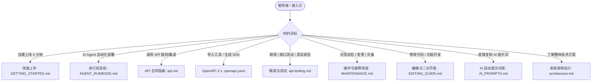

# Cloudflare EasyTmp Mail 文档体系导航

Cloudflare EasyTmp Mail 是一套免密公开、即开即用、7 天自动滚动的临时接码邮箱系统。本目录为整个项目的全景文档中心，无论是初次上线的站长、对接接口的业务工程师，还是执行自动化任务的 AI Agent（Claude Code、Codex、CPA 等），均可根据身份与目标在此快速检索所需指南。

---

## 1. 快速导航（按角色检索）

### 角色索引表

| 你的身份 / 目标 | 推荐首选文档 | 解决的核心问题 |
| --- | --- | --- |
| **自建站长 / 新手** | [GETTING_STARTED.md](GETTING_STARTED.md) | 从零 clone、改 1 个域名、授权 1 次 OAuth，5 分钟完成全自动化部署上线 |
| **AI Agent（Claude/Codex/CPA）** | [AGENT_RUNBOOK.md](AGENT_RUNBOOK.md) | 机器执行状态机、只读与变更边界、OAuth 交互规则、零凭据泄露规范、失败回退 |
| **业务系统对接方** | [api.md](api.md) | 公开免密 API 规范、完整参数、时间筛选（`since`）、严格游标分页、TypeScript/curl 示例 |
| **API 客户端生成** | [openapi.yaml](openapi.yaml) | 严格遵循 OpenAPI 3.1.0 标准的机器可读定义，直接导入 Postman/Apifox 或生成客户端 |
| **测试 / QA 工程师** | [api-testing.md](api-testing.md) | 本地与生产联调、真实邮件端到端验收、边界错误用例（400/405/413）、防误删他人邮件准则 |
| **运维 / SRE** | [MAINTENANCE.md](MAINTENANCE.md) | 日常监控指标、7 天 Cron 定时清理机制、D1 迁移、域名变更平滑演进、配置备份恢复 |
| **核心开发者 / 贡献者** | [EDITING_GUIDE.md](EDITING_GUIDE.md) | 全仓 Monorepo 架构、各端数据流转、改 API/Worker/Web/D1 的规范流程与测试门禁 |
| **Prompt 使用者** | [AI_PROMPTS.md](AI_PROMPTS.md) | 针对 Claude Code、Codex、CPA gemini-3.8-flash 的即复制即用启动、部署与联调提示词 |
| **系统架构师 / 审计员** | [architecture.md](architecture.md) | Pages + Functions + Email Worker + D1 生产拓扑、严格 DMARC 认证防线、HTML 清洗沙箱 |

---

## 2. 关键事实与设计基准

在阅读与执行任何操作前，请牢记以下系统核心设计：

1. **当前生产实例与自建部署的区别**：
   - **当前官方生产实例**：网页及 API 为 `https://inbox.cottage.dpdns.org`，收信域名为 `cottage.dpdns.org`。生产环境已稳定上线，并通过真实邮件收信、DMARC 严格校验及 Web UI 详情验证。
   - **自建部署**：项目完全可移植。你只需在根目录 `easytmp.config.json` 中配置属于你的 `mailDomain`，执行部署即可自动拥有 `inbox.<你的域名>`。文档中的 `cottage.dpdns.org` 为生产示例，非强制写死常量。
2. **公开免密设计（预期特性）**：
   - 临时接码邮箱面向即开即用设计，Web UI 与 HTTP API 均完全公开免密。
   - 任何人只要知道或生成邮箱名，均可查询与删除该邮箱名下的邮件。这属于公共临时邮箱的设计预期，无需设计任何鉴权 Token 或多租户密码。
3. **7 天不可变保留周期**：
   - 邮件生命周期严格为接收时起 `604,800,000` 毫秒（7 天）。数据库底层施加 `CHECK (expires_at = received_at + 604800000)` 硬约束。
   - 邮箱名永远不会过期；过期并被定期物理销毁的只有邮件数据。
4. **单入口零配置部署**：
   - 核心预检命令为 `pnpm onboard`，默认只读、不写云端。
   - 确认预检后运行 `pnpm onboard --apply`，自动创建/复用 D1 与 Pages，写入 Pages 生产绑定，启用 Email Routing、部署 Worker、绑定自定义域名并等待 HTTPS 冒烟验收。
5. **绝对零凭据暴露原则**：
   - 任何文档、日志、提示词与持久化配置文件中，严禁写入任何 OAuth Token、Refresh Token 或 Cloudflare API Token。

---

## 3. 文档文件清单

- [README.md](../README.md)：项目主页概览与生产索引
- [docs/README.md](README.md)：本导航页面
- [docs/GETTING_STARTED.md](GETTING_STARTED.md)：新手 5 分钟上手与部署实操指南
- [docs/AGENT_RUNBOOK.md](AGENT_RUNBOOK.md)：面向执行 Agent 的状态机与安全操作规程
- [docs/api.md](api.md)：完整 API v1 合同手册（含 curl 与 TypeScript 对接示例）
- [docs/openapi.yaml](openapi.yaml)：OpenAPI 3.1.0 机器可读规范定义
- [docs/api-testing.md](api-testing.md)：API 联调、边界测试与真实收信验收指南
- [docs/MAINTENANCE.md](MAINTENANCE.md)：运维巡检、定时清理、D1 变更与回滚手册
- [docs/EDITING_GUIDE.md](EDITING_GUIDE.md)：全栈代码架构、模块编辑流程与质量门禁指南
- [docs/AI_PROMPTS.md](AI_PROMPTS.md)：适用于各大 Agent 的标准启动与交互提示词
- [docs/architecture.md](architecture.md)：生产架构设计与技术实现白皮书
- [docs/assets/project-icon.svg](assets/project-icon.svg)：项目矢量 Logo 资产
