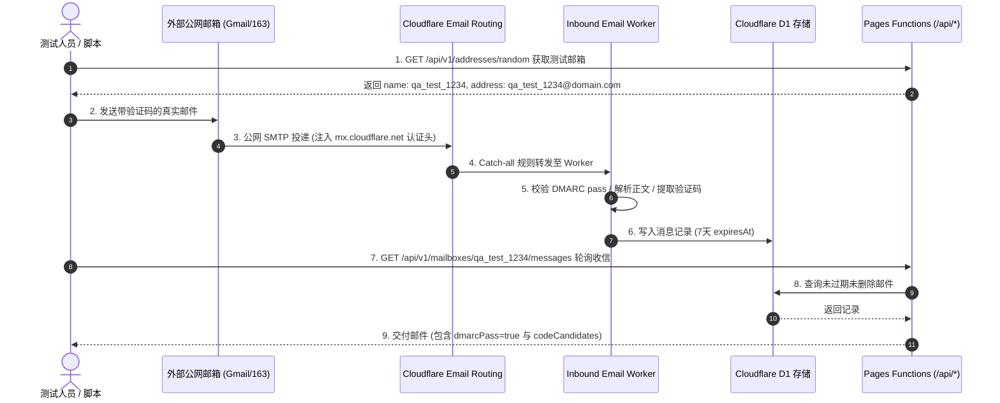

# API 联调、边界测试与真实收信验收指南

本指南面向测试工程师、QA、以及需要对 Cloudflare EasyTmp Mail 进行端到端联调和自动化测试的开发者。文档覆盖从本地到生产的完整测试脚本、真实邮件收信验收规范、HTTP 严格语义防御测试矩阵，以及生产环境下的测试安全红线。

---

## 1. 测试环境与基准配置

支持在本地全栈开发环境与线上生产环境之间无缝切换：

| 环境 | Base URL 示例 | 启动方式 / 来源 |
| --- | --- | --- |
| **本地开发环境** | `http://localhost:8788` | 运行 `pnpm pages:dev`（自动挂载本地 D1 与 Pages Functions） |
| **当前官方生产** | `https://inbox.cottage.dpdns.org` | 官方在线生产实例 |
| **自建独立生产** | `https://inbox.<你的域名>` | 运行 `pnpm onboard --apply` 部署完成后的自定义域名 |

在终端中设置全局测试变量：

```sh
# 设为目标环境地址（末尾不加斜杠）
export BASE_URL="https://inbox.cottage.dpdns.org"
```

---

## 2. 基础核心端点快速联调

### 2.1 存活检查 (GET /api/health)

```sh
curl -sS -i "$BASE_URL/api/health"
```

**预期结果**：
- HTTP 状态码：`200 OK`
- 关键标头：
  - `Cache-Control: no-store`
  - `Access-Control-Allow-Origin: *`
  - `X-Content-Type-Options: nosniff`
  - `X-Request-Id`: 包含 UUID v4 格式的请求追踪标识
- 响应 JSON：
  ```json
  {
    "status": "ok",
    "service": "easytmp-mail",
    "apiVersion": "1",
    "serverTime": 1793671200000
  }
  ```

### 2.2 公共服务配置 (GET /api/config)

```sh
curl -sS -i "$BASE_URL/api/config"
```

**预期结果**：
- HTTP 状态码：`200 OK`
- 响应包含 `mailDomain`、`webHostname`、`retentionSeconds: 604800` 以及 `addressPolicy`。
- **安全检查**：响应体内绝对不包含任何密码、Token 或私有 ID。

### 2.3 生成密码学安全随机地址 (GET /api/v1/addresses/random)

```sh
curl -sS "$BASE_URL/api/v1/addresses/random"
```

**预期结果**：
- 返回 16 位小写字母/数字的 `name`，以及完整的 `@mailDomain` 地址。

---

## 3. 真实外部邮件投递端到端验收 (Live E2E Verification)

本项测试验证 **公网 SMTP -> Cloudflare Email Routing -> Email Worker -> DMARC 验证 -> MIME 解析与清洗 -> D1 数据库持久化 -> Pages Functions 查询** 的完整业务闭环。



### 验收执行步骤

#### 步骤 1：获取独立测试邮箱并固定时间戳

```sh
RES=$(curl -sS "$BASE_URL/api/v1/addresses/random")
MAILBOX_NAME=$(echo "$RES" | grep -o '"name":"[^"]*' | cut -d'"' -f4)
TARGET_ADDR=$(echo "$RES" | grep -o '"address":"[^"]*' | cut -d'"' -f4)
SINCE_TIME=$(echo "$RES" | grep -o '"serverTime":[0-9]*' | cut -d':' -f2)

echo "验收邮箱: $TARGET_ADDR"
echo "任务起始时间: $SINCE_TIME"
```

#### 步骤 2：从外部真实邮箱发送测试邮件

使用合法的外部邮箱（如 Gmail、Outlook、企业邮箱等）向 `$TARGET_ADDR` 发送邮件：

- **邮件标题**：`EasyTmp 生产收件验收`
- **邮件正文**：
  ```text
  尊敬的测试人员：
  您的临时接码验证码为：439271
  请在 10 分钟内点击此链接进行确认：https://example.com/activate?code=439271
  退订请访问：https://example.com/unsubscribe
  ```

#### 步骤 3：轮询邮件列表接口

邮件发送后，以 3 秒间隔轮询收件箱接口（固定 `since` 为步骤 1 获取的 `SINCE_TIME`）：

```sh
curl -sS "$BASE_URL/api/v1/mailboxes/$MAILBOX_NAME/messages?since=$SINCE_TIME&limit=20"
```

#### 步骤 4：严格验收判定项

1. **秒级入库**：邮件在发送后数秒内即可从接口读出。
2. **DMARC 严格认证**：返回的 `messages[0].dmarcPass` 必须为严格的 `true`。
3. **验证码精准提取**：`messages[0].codeCandidates` 中包含数值为 `"439271"` 的项，且保留字符串格式。
4. **7 天硬性到期**：核算时间戳差值：
   `expiresAt - receivedAt === 604800000`（精确等于 7 天毫秒数）。
5. **链接提取**：调用单封邮件详情接口 `GET /api/v1/messages/{id}`，`links` 数组应包含解析出的 HTTPS 链接，且 `htmlBody` 中的危险脚本已被清洗，运行在安全的沙箱环境中。

---

## 4. HTTP 语义与安全边界测试矩阵 (Negative Test Suite)

系统针对非法请求和潜在攻击实施了业界最严密的无死角防御。以下用例可直接使用 `curl` 逐项验证：

### 4.1 非法查询参数防御（Query Param Strictness）

```sh
# 1. 存活检查不接受任何查询参数 (应返回 400 invalid_query)
curl -s -i "$BASE_URL/api/health?extra=param" | grep -E "HTTP|invalid_query"

# 2. 禁止重复查询参数 (应返回 400 invalid_query)
curl -s -i "$BASE_URL/api/v1/mailboxes/test/messages?limit=10&limit=20" | grep -E "HTTP|invalid_query"

# 3. 禁止空值查询参数 (应返回 400 invalid_query)
curl -s -i "$BASE_URL/api/v1/mailboxes/test/messages?since=" | grep -E "HTTP|invalid_query"

# 4. limit 越界拦截 (必须在 1-100 之间，应返回 400 invalid_query)
curl -s -i "$BASE_URL/api/v1/mailboxes/test/messages?limit=101" | grep -E "HTTP|invalid_query"

# 5. dmarcPass 必须严格为 true 或 false (应返回 400 invalid_query)
curl -s -i "$BASE_URL/api/v1/mailboxes/test/messages?dmarcPass=1" | grep -E "HTTP|invalid_query"
```

### 4.2 非空请求体防御（Unexpected Body Prevention）

GET、DELETE 请求严禁携带任何请求体：

```sh
# 携带非空请求体发起 GET (应返回 400 unexpected_body)
curl -s -i -X GET -d '{"evil":"payload"}' "$BASE_URL/api/health" | grep -E "HTTP|unexpected_body"

# 携带超大请求体发起请求 (超过 8192 字节，应返回 413 request_too_large)
head -c 9000 /dev/urandom | curl -s -i -X GET --data-binary @- "$BASE_URL/api/health" | grep -E "HTTP|413|request_too_large"
```

### 4.3 邮箱名格式防御（Mailbox Name Validation）

邮箱名只允许 1–64 位字母、数字、点、下划线、连字符，首尾必须是字母或数字，禁止连续点与 `+`：

```sh
# 1. 点开头 (应返回 400 invalid_mailbox_name)
curl -s -i "$BASE_URL/api/v1/mailboxes/.illegal/messages" | grep -E "HTTP|invalid_mailbox_name"

# 2. 连续双点 (应返回 400 invalid_mailbox_name)
curl -s -i "$BASE_URL/api/v1/mailboxes/test..mail/messages" | grep -E "HTTP|invalid_mailbox_name"

# 3. 包含 + 子地址 (应返回 400 invalid_mailbox_name)
curl -s -i "$BASE_URL/api/v1/mailboxes/test+tag/messages" | grep -E "HTTP|invalid_mailbox_name"

# 4. 超过 64 字符 (应返回 400 invalid_mailbox_name)
LONG_NAME=$(printf 'a%.0s' {1..65})
curl -s -i "$BASE_URL/api/v1/mailboxes/$LONG_NAME/messages" | grep -E "HTTP|invalid_mailbox_name"
```

### 4.4 消息 ID 与 UUID 校验

```sh
# 传递非 UUID v4 格式的非法 ID (应返回 400 invalid_message_id)
curl -s -i "$BASE_URL/api/v1/messages/123456" | grep -E "HTTP|invalid_message_id"
```

### 4.5 游标防篡改（Cursor Cryptographic Integrity）

```sh
# 传递伪造或损坏的 Base64 游标 (应返回 400 invalid_cursor)
curl -s -i "$BASE_URL/api/v1/mailboxes/test/messages?cursor=invalid_tampered_cursor" | grep -E "HTTP|invalid_cursor"
```

### 4.6 路由与 HTTP 方法防御

```sh
# 1. 未定义路由必须返回纯 JSON 格式的 404 (绝不回退至 SPA HTML)
curl -s -i "$BASE_URL/api/not_exist_route" | grep -E "HTTP|route_not_found|application/json"

# 2. 已有路由使用不支持的方法必须返回 405 并声明 Allow 标头
curl -s -i -X POST "$BASE_URL/api/health" | grep -E "HTTP|405|Allow:"
```

---

## 5. 生产环境测试安全红线（重要警告）

在针对 **官方生产实例** 或 **已有在线用户/业务对接** 的环境进行接口联调时，必须严格遵守以下测试纪律：

> ⚠️ **生产测试红线：严禁在生产环境随意删除他人邮件！**
>
> 1. **公开免密特性须知**：本系统的邮箱为完全公开模型，同名邮箱不设账户密码隔离。
> 2. **测试邮箱专属命名**：测试发信和收件联调时，**必须** 使用专用命名（如通过 `/api/v1/addresses/random` 生成的随机地址，或前缀为 `test-qa-<时间戳>` 的专用邮箱名）。
> 3. **严禁清空公共邮箱**：**绝对不可** 对 `signup`、`admin`、`test` 等常用公共测试邮箱执行 `DELETE /api/v1/mailboxes/{name}/messages`（批量清空）操作。
> 4. **删除接口验证规范**：若需验证邮件删除功能（`DELETE /api/v1/messages/{id}`），只能删除在本次测试中由你本人发送并验证完成的指定单封邮件。

---

## 6. OpenAPI 规范校验与 Lint

在修改 API 接口或提交 PR 之前，必须对 [openapi.yaml](openapi.yaml) 规范文件进行格式与语法校验：

```sh
# 使用 Python PyYAML 进行机器可读语法验证
python3 -c "
import yaml
with open('docs/openapi.yaml', 'r') as f:
    doc = yaml.safe_load(f)
assert doc['openapi'] == '3.1.0'
assert '/api/health' in doc['paths']
assert '/api/config' in doc['paths']
assert '/api/v1/mailboxes/{name}/messages' in doc['paths']
print('✓ OpenAPI 3.1 规范语法与端点校验全部通过！')
"
```

若本地安装了 OpenAPI CLI 或 Spectral，可执行更深度的 Lint 检查：
```sh
npx @redocly/cli lint docs/openapi.yaml
```
