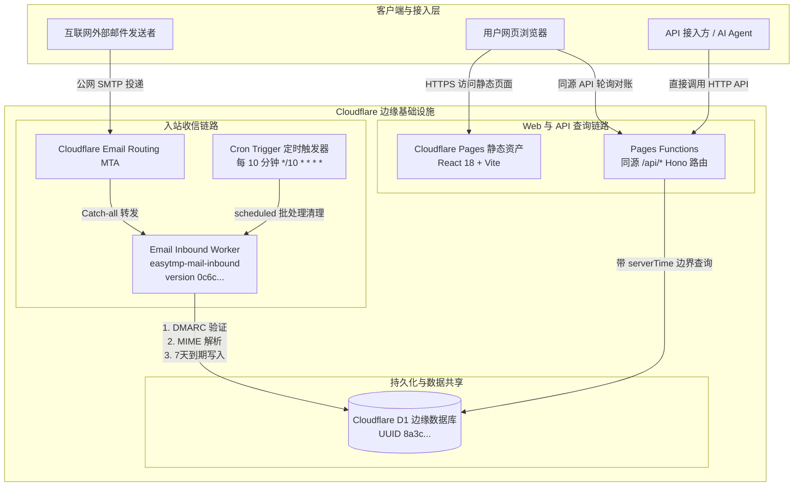

# Cloudflare EasyTmp Mail 生产架构与系统设计

**状态**：v1 生产稳定上线  
**官方生产实例**：`https://inbox.cottage.dpdns.org`  
**官方生产收信域**：`cottage.dpdns.org`  
**部署架构特性**：全栈 Serverless，完全可移植，单域名配置驱动

Cloudflare EasyTmp Mail 是一套基于 Cloudflare 生态（Pages + Pages Functions + Email Worker + D1）构建的免密、公开、即开即用、7 天自动滚动的临时接码邮箱系统。本架构设计已通过真实邮件投递、DMARC 严格防伪造、验证码/链接抽取、7 天生命周期硬约束、HTML 清洗与 Web 隔离沙箱等多维生产级验证。

---

## 1. 架构总览与拓扑结构

系统全部组件均部署在 Cloudflare 全球边缘网络，不依赖任何外部集中式服务器或第三方付费服务。



---

## 2. 核心组件与系统职责划分

### 2.1 邮件接收引擎 (Email Inbound Worker)
- **部署形式**：Cloudflare Email Worker（生产实例名为 `easytmp-mail-inbound`，版本标识 `0c6c...`）。
- **职责范围**：
  1. **收件人归一化**：提取标准 `local-part`，检验 1–64 字符规范，自动转小写。
  2. **防超大邮件炸弹**：基于流式大小控制，邮件体硬限为 1MB（最高允许 2MB），超限在边缘阶段安全拒收。
  3. **严格 DMARC 认证防伪造**：仅检验邮件最上方由 Cloudflare Email Routing MTA 注入的首个 `Authentication-Results` 头，严格校验 `authserv-id` 必须为 `mx.cloudflare.net`；正文伪造头与后续中继头严格忽略。
  4. **MIME 深度解析与清洗**：解析纯文本正文、HTML 正文、抽取 4-12 位前导零验证码（`codeCandidates`）与合法 HTTPS 链接。
  5. **注入 7 天不可变保留期**：设定 `receivedAt = Date.now()`，`expiresAt = receivedAt + 604800000`（精确 7 天毫秒数）。
  6. **定时垃圾回收 (Scheduled Handler)**：每 10 分钟由 Cron 触发一次，执行批处理物理清理（单次上限 1000 封），防止无界积压与 D1 存储超限。

### 2.2 全栈 API 网关 (Cloudflare Pages Functions)
- **部署形式**：同源嵌入在 Pages 内部的 `/api/*` 处理函数，基于现代 Hono 框架构建。
- **职责范围**：
  1. **全局统一中间件**：在请求入口固定权威 `serverTime`（毫秒），并分发全局唯一的 `requestId`（UUID v4）。
  2. **严格 HTTP 语义防御**：
     - 快速拦截 Content-Length > 8192 字节（`413 request_too_large`）。
     - GET/DELETE 强行禁止携带请求体（`400 unexpected_body`）。
     - 未声明、重复或空值查询参数立即阻断（`400 invalid_query`）。
  3. **公开端点服务**：提供 `/api/health` 存活检查、`/api/config` 零密钥配置下发、`/api/v1/addresses/random` 密码学安全随机地址生成、收件箱列表分页查询及单封邮件/邮箱清空等。
  4. **严格双重时效判定**：所有读取与删除 SQL 强制携带 `expires_at > serverTime`，实现到期即时逻辑不可见。

### 2.3 静态界面与安全沙箱 (Cloudflare Pages)
- **部署形式**：React 18 + Vite 生产编译产物（生产实例名为 `easytmp-mail`），绑定自定义域名 `https://inbox.cottage.dpdns.org`。
- **职责范围**：
  1. **零硬编码动态自适应**：前端启动时先拉取 `/api/config`，自动获得当前部署的邮件域名及保留规则。
  2. **极简操作交互**：支持直接输入前缀或一键生成随机邮箱，支持验证码快捷复制。
  3. **权威状态机与休眠机制**：3 秒长轮询自动对账；当浏览器标签页处于后台不可见状态时彻底挂起定时器，恢复可见时立即触发主动刷新，保护客户端电量与边缘带宽。
  4. **srcdoc 隔离沙箱**：HTML 邮件展示在配置了严格安全标头（`frame-src 'self' about:`）的 `srcdoc` iframe 沙箱中，阻止外部恶意代码执行与隐私追踪。

### 2.4 数据存储核心 (Cloudflare D1)
- **部署形式**：Cloudflare 分布式边缘 SQL 数据库（生产实例名为 `easytmp-mail`，UUID 标识为 `8a3c...`）。
- **职责范围**：
  - 存储邮件元数据、发件人、收件邮箱、纯文本、清洗后 HTML、验证码候选及链接候选。
  - **Schema CHECK 硬约束**：数据库底层强制 `CHECK (expires_at = received_at + 604800000)`，从根本上防止数据被篡改或无限期驻留。

---

## 3. 端到端核心业务数据流

### 3.1 邮件入站与持久化流 (Inbound Email Flow)

```text
外部发件 MTA (如 Gmail)
  │ (1. SMTP 发信)
  ▼
Cloudflare Email Routing (MX: route1/2/3.mx.cloudflare.net)
  │ (2. 平台认证并前置注入 Authentication-Results: mx.cloudflare.net; dmarc=pass)
  ▼
Email Inbound Worker (easytmp-mail-inbound)
  ├─► [校验 1] 收件域名必须严格等于配置的 mailDomain
  ├─► [校验 2] 邮件大小流式检查 (<= 1MB)
  ├─► [校验 3] 提取首个 Authentication-Results，验证 authserv-id == mx.cloudflare.net
  ├─► [解析 4] MIME 解析、HTML parse5 白名单清洗、验证码提取
  ├─► [时间 5] 设定 receivedAt = now(), expiresAt = now() + 604800000
  ▼
Cloudflare D1 数据库 (INSERT INTO messages ...)
```

### 3.2 邮件查询与分页对账流 (Query & Reconcile Flow)

```text
客户端 (Browser / Agent)
  │ (1. 发起 GET /api/v1/mailboxes/{name}/messages?since=T&limit=20)
  ▼
Pages Functions (/api/*)
  ├─► [中间件] 记录请求 serverTime 与生成 requestId
  ├─► [校验] 参数白名单校验、邮箱名合法性归一化校验
  ├─► [SQL 查询] SELECT ... FROM messages WHERE address = ? AND expires_at > serverTime AND received_at >= since ...
  ├─► [游标编码] 基于最后一条记录的 (receivedAt, id) 计算严格 Base64URL Cursor
  ▼
返回 JSON 响应 (包含 messages[], pagination.nextCursor, serverTime)
```

### 3.3 定时物理清理流 (Cron Cleanup Flow)

```text
Cloudflare Cron Scheduler (每 10 分钟触发)
  │
  ▼
Inbound Worker scheduled(event, env)
  │
  ├─► 循环分批调用 D1: DELETE FROM messages WHERE expires_at <= ? LIMIT 100
  ├─► 累加删除数量，受单次调用上限 1000 封硬约束保护
  ▼
控制台输出脱敏汇总: "Cron scheduled cleanup deleted N expired messages"
```

---

## 4. 安全架构与防御模型

1. **公开免密设计（预期特性）**：
   临时邮箱面向公开、免密、即用即弃场景设计，无用户体系或 API 访问密钥。任何知道邮箱名的人均可查询与删除该邮箱下的邮件。接入方应通过高强度的随机邮箱名（如 16 位均匀随机字符）保障会话私密性。
2. **防发件人伪造 (Strict Anti-Spoofing)**：
   - 绝不信任发件人自带的 `Authentication-Results` 头。
   - 校验逻辑截断在 RFC 5322 标头边界（`\r\n\r\n`），忽略正文中伪造的假标头。
   - 严格限定 MTA 白名单标识为官方 `mx.cloudflare.net`，阻止恶意构造的二级伪造域（如 `mx.cloudflare.net.evil.com`）。
3. **HTML 注入与 XSS 防护**：
   - 邮件 HTML 经 `parse5` 与项目自有标签/属性/样式白名单严格过滤，剔除 `<script>`、`<object>`、`<form>` 及所有 `on*` 事件属性。
   - 前端采用 `srcdoc` iframe 沙箱隔离，限定 `sandbox="allow-popups allow-popups-to-escape-sandbox"`，禁止脚本执行。
4. **全链路凭据安全**：
   - 系统运行不依赖任何持久化在文件中的静态 API Token。
   - 部署过程依托本地 Wrangler OAuth 会话，自动回写的配置仅包含公开的资源 ID（Zone ID、Account ID、D1 UUID）。

---

## 5. 生产资源矩阵

### 官方生产环境资源事实

| 资源类别 | 资源标识 / 生产值 | 状态与说明 |
| --- | --- | --- |
| **收件域名** | `cottage.dpdns.org` | Cloudflare 激活 Zone，平台托管 MX/SPF/DKIM |
| **Web 与 API 域名** | `inbox.cottage.dpdns.org` | Proxied CNAME 指向 Pages，全站强制 HTTPS |
| **Pages 实例** | `easytmp-mail` | 承载 React 前端与同源 `/api/*` Functions |
| **Email Worker** | `easytmp-mail-inbound` (版本 `0c6c...`) | 承载邮件接收解析与 Cron 定时清理 |
| **D1 数据库** | `easytmp-mail` (UUID: `8a3c...`) | 亚太区域（apac），带 7 天 CHECK 约束 |
| **历史旧服务** | `email-code-worker` | **已于 2026-11-03 彻底下线删除** |
| **平台托管 MX** | `route1.mx.cloudflare.net` (97)<br>`route2.mx.cloudflare.net` (12)<br>`route3.mx.cloudflare.net` (5) | Cloudflare Email Routing 官方接信集群 |
| **平台托管 SPF** | `v=spf1 include:_spf.mx.cloudflare.net ~all` | 保护邮件域的 SPF 策略 |

### 自建部署派生规则表

当在 `easytmp.config.json` 中配置自定义 `mailDomain` 时，系统依据下表自动派生并创建资源：

| 资源类别 | 自动派生规则 | 示例 (`example.com`) |
| --- | --- | --- |
| **收件域名** | 配置的 `mailDomain` | `example.com` |
| **Web 域名** | `inbox.<mailDomain>` | `inbox.example.com` |
| **Pages 项目** | `easytmp-<域名主标签>` | `easytmp-example` |
| **Worker 脚本** | `easytmp-<域名主标签>-worker` | `easytmp-example-worker` |
| **D1 数据库** | `easytmp-<域名主标签>` | `easytmp-example` |
